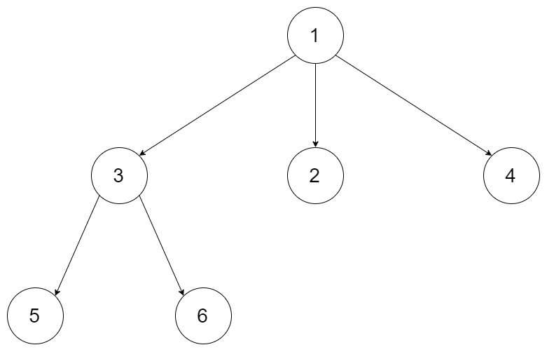

给定一个 N 叉树，返回其节点值的*层序遍历*。（即从左到右，逐层遍历）。

树的序列化输入是用层序遍历，每组子节点都由 null 值分隔（参见示例）。

示例 1：



```C++
输入：root = [1,null,3,2,4,null,5,6]
输出：[[1],[3,2,4],[5,6]]
```

## 思路：

根据队列先进先出的特点进行宽搜，用一个vector数组记录每一层的数

```C++
class Solution {
public:
    vector<vector<int>> levelOrder(Node* root)
    {
        vector<vector<int>> ret;//存放结果
        queue<Node*> q;//队列
        if(root == nullptr) return ret;
        q.push(root);
        //当队列里不为空
        while(q.size())
        {
            //记录队列有几个数，有几个数就出列几次
            int sz = q.size();
            //统计本层的节点
            vector<int> tmp;
            for(int i = 0;i<sz;i++)
            {
                //得出对头然后出列,再统计到本层数组中
                Node* t = q.front();
                //统计到本层数组
                tmp.push_back(t->val);
                //出列
                q.pop();
                //将下一层的入列
                for(auto child : t->children)
                {
                    if(child != nullptr)
                    q.push(child);
                }
            }
            ret.push_back(tmp);
        }
        return ret;
    }
};
```
