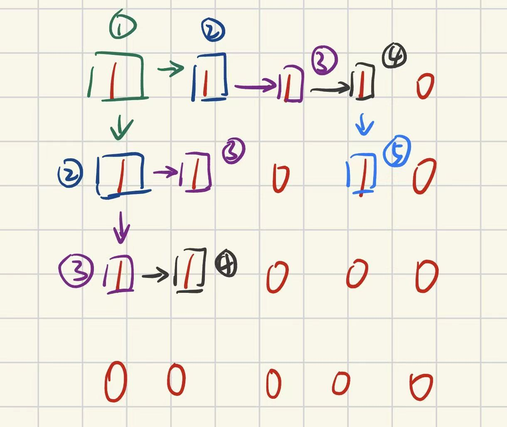

给你一个由 `'1'`（陆地）和 `'0'`（水）组成的的二维网格，请你计算网格中岛屿的数量。

岛屿总是被水包围，并且每座岛屿只能由水平方向和/或竖直方向上相邻的陆地连接形成。

此外，你可以假设该网格的四条边均被水包围。

示例 1：

```C++
输入：grid = [
  ['1','1','1','1','0'],
  ['1','1','0','1','0'],
  ['1','1','0','0','0'],
  ['0','0','0','0','0']
]
输出：1
```

## 思路：按照下图路径宽度优先遍历



```C++
class Solution {
    int dir[4][2] = {{-1,0},{1,0},{0,-1},{0,1}};
    int count = 0;
    typedef pair<int,int> PII;
public:
    int numIslands(vector<vector<char>>& grid)
    {
        int m = grid.size();
        int n = grid[0].size();
        //从头开始寻找
        for(int i = 0;i<m;i++)
        {
            for(int j = 0;j<n;j++)
            {
                if(grid[i][j] == '1')
                {
                    count++;
                    //开始bfs淹没这座岛屿直到队列为空才开始找下一个1
                    queue<PII> q;
                    q.push({i,j});
                    //找到1就直接淹没
                    grid[i][j] = '0';
                    while(q.size())
                    {
                        //获取队列中的坐标数据
                        auto [a,b] = q.front();
                        q.pop();
                        for(int k = 0;k<4;k++)
                        {
                            int x = a + dir[k][0];
                            int y = b + dir[k][1];
                            if(x >= 0 && x < m && y >= 0 && y < n && grid[x][y] == '1')
                            {
                                //直接淹没
                                grid[x][y] = '0';
                                q.push({x,y});
                            }
                        }
                    }
                }
            }
        }
        return count;
    }
};
```
