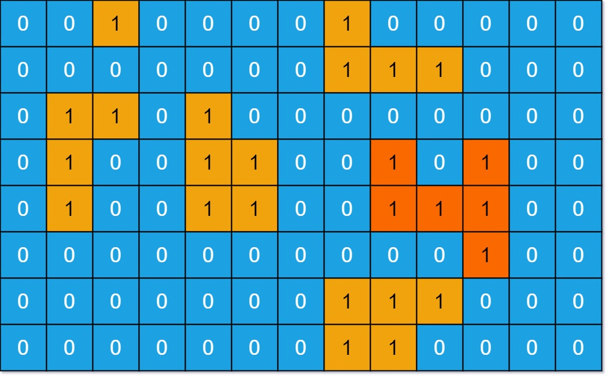

给定一个由 `0` 和 `1` 组成的非空二维数组 `grid`，用来表示海洋岛屿地图。

一个 岛屿 是由一些相邻的 `1` (代表土地) 构成的组合，这里的「相邻」要求两个 `1` 必须在水平或者竖直方向上相邻。你可以假设 `grid` 的四个边缘都被 `0`（代表水）包围着。

找到给定的二维数组中最大的岛屿面积。如果没有岛屿，则返回面积为 `0`。

示例 1：



```C++
输入: grid = [[0,0,1,0,0,0,0,1,0,0,0,0,0],[0,0,0,0,0,0,0,1,1,1,0,0,0],[0,1,1,0,1,0,0,0,0,0,0,0,0],[0,1,0,0,1,1,0,0,1,0,1,0,0],[0,1,0,0,1,1,0,0,1,1,1,0,0],[0,0,0,0,0,0,0,0,0,0,1,0,0],[0,0,0,0,0,0,0,1,1,1,0,0,0],[0,0,0,0,0,0,0,1,1,0,0,0,0]]
输出: 6
解释: 对于上面这个给定矩阵应返回 6。注意答案不应该是 11 ，因为岛屿只能包含水平或垂直的四个方向的 1 。
```

```C++
class Solution {
    int dir[4][2] = {{0, -1}, {0, 1}, {1, 0}, {-1, 0}};
    typedef pair<int, int> PII;
public:
    int maxAreaOfIsland(vector<vector<int>>& grid)
    {
        if (grid.empty() || grid[0].empty())
            return 0;
        int m = grid.size();
        int n = grid[0].size();
        int maxarea = 0;
        for (int i = 0; i < m; i++)
        {
            for (int j = 0; j < n; j++)
            {
                queue<PII> q;
                //针对这一个1 bfs
                if (grid[i][j] == 1)
                {
                    //到下一组重置curarea，避免累加
                    int curarea = 0;
                    q.push({i, j});
                    grid[i][j] = 0;
                    //对于某一座岛屿的bfs
                    while (q.size())
                    {
                        //获取队头坐标
                        auto [a, b] = q.front();
                        q.pop();
                        //出队一个就++
                        curarea++;
                        //遍历选择到的1的四周，符合条件的加入队列
                        for (int k = 0; k < 4; k++)
                        {
                            int x = a + dir[k][0];
                            int y = b + dir[k][1];
                            if (x >= 0 && x < m && y >= 0 && y < n && grid[x][y] == 1)
                            {
                                grid[x][y] = 0;
                                q.push({x, y});
                            }
                        }
                        maxarea = max(maxarea, curarea);
                    }
                }
            }
        }
        return maxarea;
    }
};
```
