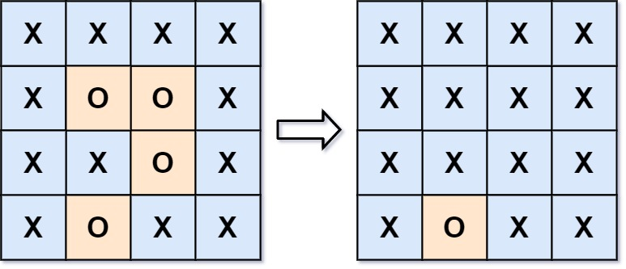

给你一个 `m x n` 的矩阵 `board`，由若干字符 `'X'` 和 `'O'` 组成，捕获 所有 被围绕的区域：

- 连接：一个单元格与水平或垂直方向上相邻的单元格连接。

- 区域：连接所有 `'O'` 的单元格来形成一个区域。

- 围绕：如果一个区域中的所有 `'O'` 单元格都不在棋盘的边缘，则该区域被包围。这样的区域 完全 被 `'X'` 单元格包围。

通过 原地 将输入矩阵中的所有 `'O'` 替换为 `'X'` 来 捕获被围绕的区域。你不需要返回任何值。

示例 1：

输入：board = [['X','X','X','X'],['X','O','O','X'],['X','X','O','X'],['X','O','X','X']]

输出：[['X','X','X','X'],['X','X','X','X'],['X','X','X','X'],['X','O','X','X']]

解释：



在上图中，底部的区域没有被捕获，因为它在 board 的边缘并且不能被围绕。

## 思路：将四个边缘所有的O以及与它们直接相连的O替换为A，最后直接全盘搜索，将A还原为O，将O换成X

```C++
class Solution
{
    typedef pair<int,int> PII;
    int dir[4][2] = {{0,-1},{0,1},{-1,0},{1,0}};
    int m,n;
public:
    void solve(vector<vector<char>>& board)
    {
        if(board.empty() || board[0].empty()) return;
        m = board.size();
        n = board[0].size();
        for(int i =0;i<m;i++)
        {
            //查找左边缘
            if(board[i][0] == 'O') bfs(board,i,0);
            //查找右边缘
            if(board[i][n-1] == 'O') bfs(board,i,n-1);
        }
        for(int j = 0;j<n;j++)
        {
            //查找上边缘
            if(board[0][j] == 'O') bfs(board,0,j);
            //查找下边缘
            if(board[m-1][j] == 'O') bfs(board,m-1,j);
        }
        for(int i = 0;i<m;i++)
        {
            for(int j = 0;j<n;j++)
            {
                if(board[i][j] =='A')
                board[i][j] = 'O';
                else if (board[i][j] == 'O')
                board[i][j] = 'X';
            }
        }
    }
    void bfs(vector<vector<char>>& board,int i,int j)
    {
        queue<PII> q;
        //处理选中的单个
        q.push({i,j});
        board[i][j] = 'A';
        //bfs处理剩下的，符合条件的入队，一个一个改
        while(q.size())
        {
            //获取选中的格子的坐标
            auto [a,b] = q.front();
            q.pop();
            for(int k = 0;k<4;k++)
            {
                int x = a + dir[k][0];
                int y = b + dir[k][1];
                if(x >= 0 && x < m && y >= 0 && y < n && board[x][y] == 'O')
                {
                    board[x][y] = 'A';
                    q.push({x,y});
                }
            }
        }
    }
};
```
