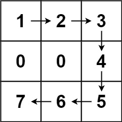

你被请来给一个要举办高尔夫比赛的树林砍树。树林由一个 `m x n` 的矩阵表示， 在这个矩阵中：

- `0` 表示障碍，无法触碰

- `1` 表示地面，可以行走

- `比 1 大的数` 表示有树的单元格，可以行走，数值表示树的高度

每一步，你都可以向上、下、左、右四个方向之一移动一个单位，如果你站的地方有一棵树，那么你可以决定是否要砍倒它。

你需要按照树的高度从低向高砍掉所有的树，每砍过一颗树，该单元格的值变为 `1`（即变为地面）。

你将从 `(0, 0)` 点开始工作，返回你砍完所有树需要走的最小步数。 如果你无法砍完所有的树，返回 `-1`。

可以保证的是，没有两棵树的高度是相同的，并且你至少需要砍倒一棵树。

示例 1：



```C++
输入：forest = [[1,2,3],[0,0,4],[7,6,5]]
输出：6
解释：沿着上面的路径，你可以用 6 步，按从最矮到最高的顺序砍掉这些树。
```

## 思路：

本质找最短路径以1→2→3→4→5为例，就是分别找1→2的最短路，2→3的最短路，3→4的最短路.....用一个`vector`数组结合`sort`对这里面的数进行排序

```C++
class Solution {
    int dir[4][2] = {{0,-1},{0,1},{1,0},{-1,0}};
public:
    int cutOffTree(vector<vector<int>>& forest)
    {
        int m = forest.size();
        int n = forest[0].size();
        //用一个vector数组存放地图数据,格式{高度，横坐标，纵坐标}
        vector<vector<int>> trees;
        for(int i = 0;i<m;i++)
        {
            for(int j = 0;j<n;j++)
            {
                if(forest[i][j] > 1)
                trees.push_back({forest[i][j],i,j});
            }
        }
        //用sort排序
        sort(trees.begin(),trees.end());
        //记录当前的起点
        int curR = 0,curC = 0;
        int tottalsteps = 0;
        //记录目标坐标同时进行 bfs搜索 判断能否到达 更新起点
        for(auto tree : trees)
        {
            int targetR = tree[1];
            int targetC = tree[2];
            int steps = bfs(forest,curR,curC,targetR,targetC);
            if(steps == -1) return -1;
            tottalsteps += steps;
            curR = targetR;
            curC = targetC;
        }
        return tottalsteps;
    }
    int bfs(vector<vector<int>>& forest,int startR,int startC, int targetR,int targetC)
    {
        int m = forest.size();
        int n = forest[0].size();
        if(startC == targetC && startR == targetR) return 0;
        //用一个bool数组标记
        vector<vector<bool>> vis(m,vector<bool>(n,false));
        //存坐标
        queue<pair<int,int>> q;
        q.push({startR,startC});
        //标记走过
        vis[startR][startC] = true;
        int steps = 0;
        while(q.size())
        {
            int sz = q.size();
            steps++;
            for(int i = 0;i<sz;i++)
            {
                //获取坐标信息
                auto [a,b] = q.front();
                q.pop();
                for(int k = 0;k<4;k++)
                {
                    int x = a + dir[k][0];
                    int y = b + dir[k][1];
                    //如果没越界 没走过 不是障碍，就分情况讨论是目的地还是合法路径
                    if(x >= 0 && x < m && y >= 0 && y < n && vis[x][y] == false && forest[x][y] > 0)
                    {
                        //目的地
                        if(x == targetR && y == targetC) return steps;
                        vis[x][y] = true;
                        q.push({x,y});
                    }
                }
            }
        }
        return -1;
    }
};
```
