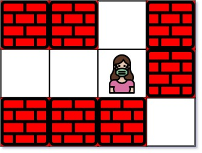

给你一个 `m x n` 的迷宫矩阵 `maze` （下标从 0 开始），矩阵中有空格子（用 `'.'` 表示）和墙（用 `'+'` 表示）。同时给你迷宫的入口 `entrance`，用 `entrance = [entrancerow, entrancecol]` 表示你一开始所在格子的行和列。

每一步操作，你可以往 上，下，左 或者 右 移动一个格子。你不能进入墙所在的格子，你也不能离开迷宫。你的目标是找到离 `entrance` 最近 的出口。出口 的含义是 `maze` 边界 上的 空格子。`entrance` 格子 不算 出口。

请你返回从 `entrance` 到最近出口的最短路径的 步数，如果不存在这样的路径，请你返回 `-1`。

示例 1：



```C++
输入：maze = [["+","+",".","+"],[".",".",".","+"],["+","+","+","."]], entrance = [1,2]
输出：1
解释：总共有 3 个出口，分别位于 (1,0)，(0,2) 和 (2,3) 。
一开始，你在入口格子 (1,2) 处。
- 你可以往左移动 2 步到达 (1,0) 。
- 你可以往上移动 1 步到达 (0,2) 。
从入口处没法到达 (2,3) 。
所以，最近的出口是 (0,2) ，距离为 1 步。
```

## 思路：

用一个bool二维数组标记，每当一层+它的四周遍历完成并没有返回就让step++，在遍历的过程中要查：越界，撞墙，重复遍历 → continue以及到达便捷出口 → return steps

```C++
class Solution {
    int dir[4][2] = {{0,-1},{0,1},{-1,0},{1,0}};
    typedef pair<int,int> PII;
public:
    int nearestExit(vector<vector<char>>& maze, vector<int>& entrance)
    {
        if(maze.empty() || maze[0].empty()) return -1; // 空迷宫返回-1
        int m = maze.size();
        int n = maze[0].size();
        //用 bool 二维数组记录
        vector<vector<bool>> visited(m,vector<bool>(n,false));
        queue<PII> q;
        //将初始坐标入队
        q.push({entrance[0], entrance[1]});
        //标记起点
        visited[entrance[0]][entrance[1]] = true;
        int steps = 0;
        while(!q.empty())
        {
            int sz = q.size();
            //只要一层循环结束就加步数
            steps++;
            for(int i = 0; i < sz; i++)
            {
                //提取队头坐标并查找四周
                auto [a, b] = q.front();
                q.pop();
                for(int k = 0; k < 4; k++)
                {
                    int x = a + dir[k][0];
                    int y = b + dir[k][1];
                    //只加入不越界 不是出口 不是墙 没有走过的路径到队列作为下一层
                    // 越界，或者是墙，或者是走过的路，直接跳过
                    if(x < 0 || x >= m || y < 0 || y >= n || maze[x][y] == '+' || visited[x][y]) continue;
                    // 如果是出口，直接返回步数
                    if(x == 0 || x == m-1 || y == 0 || y == n-1)  return steps;
                    // 均不是上面的情况 只是路过 就标记并入队
                    visited[x][y] = true;
                    q.push({x, y});
                }
            }
        }
        return -1;
    }
};
```
