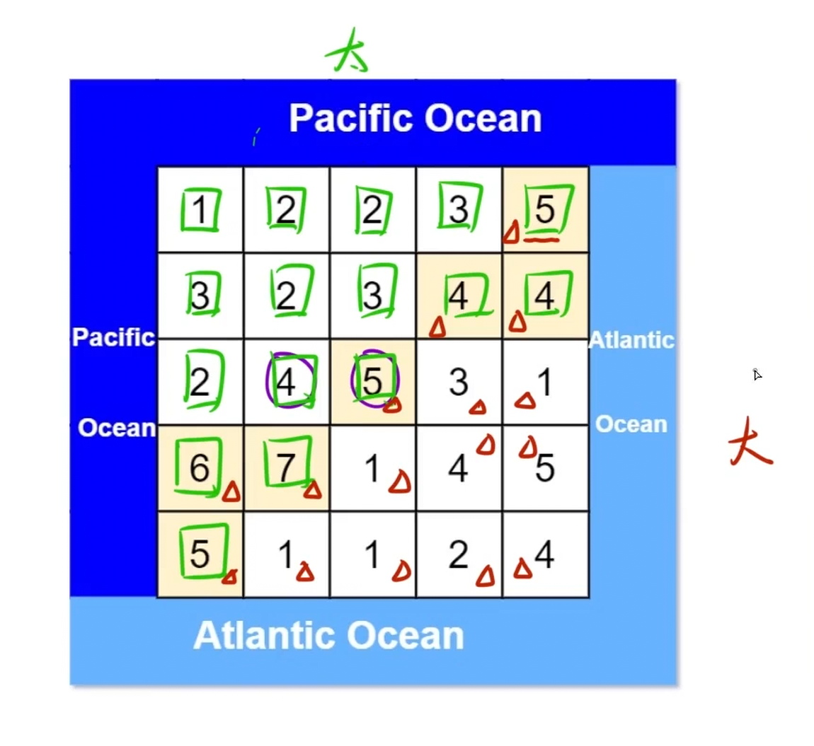

有一个 `m × n` 的矩形岛屿，与 太平洋 和 大西洋 相邻。 “太平洋” 处于大陆的左边界和上边界，而 “大西洋” 处于大陆的右边界和下边界。

这个岛被分割成一个由若干方形单元格组成的网格。给定一个 `m x n` 的整数矩阵 `heights`， `heights[r][c]` 表示坐标 `(r, c)` 上单元格 高于海平面的高度。

岛上雨水较多，如果相邻单元格的高度 小于或等于 当前单元格的高度，雨水可以直接向北、南、东、西流向相邻单元格。水可以从海洋附近的任何单元格流入海洋。

返回网格坐标 `result` 的 2D 列表，其中 `result[i] = [ri, ci]` 表示雨水从单元格 `(ri, ci)` 流动 既可流向太平洋也可流向大西洋。

示例 1：


```C++
输入: heights = [[1,2,2,3,5],[3,2,3,4,4],[2,4,5,3,1],[6,7,1,4,5],[5,1,1,2,4]]
输出: [[0,4],[1,3],[1,4],[2,2],[3,0],[3,1],[4,0]]
```

## 思路：



利用正难则反的思路，考虑当水灌进来之后的路线，分别求出哪些点可以进入大西洋，哪些点可以进入太平洋，最后去交集即可。现在左右 上下边界递归，标记格子的状态，最后再逐个遍历求交集

```C++
class Solution
{
    int m,n;
    int dir[4][2] = {{-1,0},{1,0},{0,-1},{0,1}};
public:
    vector<vector<int>> pacificAtlantic(vector<vector<int>>& heights)
    {
        m = heights.size();
        n = heights[0].size();
        //存放结果
        vector<vector<int>> ret;
        if(heights.empty() || heights[0].empty()) return ret;
        //标记数组
        vector<vector<bool>> pacific(m,vector<bool>(n,false));
        vector<vector<bool>> atlantic(m,vector<bool>(n,false));
        //处理左右边缘
        for(int i = 0;i<m;i++)
        {
            //左太平洋
            dfs(heights,i,0,pacific);
            //右大西洋
            dfs(heights,i,n-1,atlantic);
        }
        for(int j = 0;j<n;j++)
        {
            //上太平洋
            dfs(heights,0,j,pacific);
            //下大西洋
            dfs(heights,m-1,j,atlantic);
        }
        for(int i = 0;i<m;i++)
        {
            for(int j = 0;j<n;j++)
            {
                if(pacific[i][j] && atlantic[i][j])
                ret.push_back({i,j});
            }
        }
        return ret;
    }
    void dfs(vector<vector<int>>& heights,int i,int j,vector<vector<bool>>& vis)
    {
        if(i < 0 || i >= m || j < 0 || j >= n || vis[i][j]) return;
        //标记
        vis[i][j] = true;
        //四周深搜执行标记
        for(int k = 0;k<4;k++)
        {
            int x = i + dir[k][0];
            int y = j + dir[k][1];
            //不越界且下一个格子的海水高度 >= 当前格子海水高度才继续
            if(x >= 0 && x < m && y >= 0 && y < n && heights[x][y] >= heights[i][j])
            dfs(heights,x,y,vis);
        }
    }
};
```

标记数组和引用部分用c的风格可以这么写：

```C++
//标记数组
bool pacific[201][201] = {false};
bool atlantic[201][201] = {false}
void dfs(vector<vector<int>>& heights,int i,int j,bool (&vis)[201][201])
```
