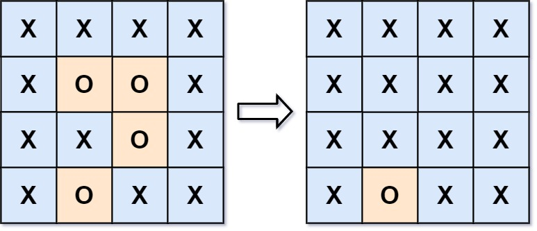

给你一个 `m x n` 的矩阵 `board`，由若干字符 `'X'` 和 `'O'` 组成，捕获 所有 被围绕的区域：

- 连接：一个单元格与水平或垂直方向上相邻的单元格连接。

- 区域：连接所有 `'O'` 的单元格来形成一个区域。

- 围绕：如果一个区域中的所有 `'O'` 单元格都不在棋盘的边缘，则该区域被包围。这样的区域 完全 被 `'X'` 单元格包围。

通过 原地 将输入矩阵中的所有 `'O'` 替换为 `'X'` 来 捕获被围绕的区域。你不需要返回任何值。

示例 1：

输入：board = [['X','X','X','X'],['X','O','O','X'],['X','X','O','X'],['X','O','X','X']]

输出：[['X','X','X','X'],['X','X','X','X'],['X','X','X','X'],['X','O','X','X']]

解释：



在上图中，底部的区域没有被捕获，因为它在 board 的边缘并且不能被围绕。

## 思路：

用反向思维，先把边缘的`'O'`找出来并标记为安全的O(不用染色):`'A'`,通过探寻四周找到所有和`边缘 'O'` 直接或间接相连的 `'O'`，在代码运行时，都会被临时标记成 `'A'`（代表安全区）。最后再把它们恢复成`'O'`，通过递归完成以上步骤后，就可以开始逐个搜索，只要搜到'O'那就是被包围的

```C++
class Solution
{
    int dir[4][2] = {{-1,0},{1,0},{0,-1},{0,1}};
    int m,n;
public:
    void solve(vector<vector<char>>& board)
    {
        if(board.empty() || board[0].empty()) return;
        m = board.size();
        n = board[0].size();
        //把边缘的'O'全部换成'A'，并且深搜四周，如果不是'O'也换成A，这样处理完边缘只要搜索到'O'那就一定是被包围的
        for(int i = 0;i<m;i++)
        {
            //左边缘
            if(board[i][0] == 'O') dfs(board,i,0);
            //右边缘
            if(board[i][n-1] == 'O') dfs(board,i,n-1);
        }
        for(int j = 0;j<n;j++)
        {
            //上边缘
            if(board[0][j] == 'O') dfs(board,0,j);
            //下边缘
            if(board[m-1][j] == 'O') dfs(board,m-1,j);
        }
        //处理完边缘后开始逐个搜索，只要搜到'O'即是被包围的，搜到'A'就还原
        for(int i = 0;i<m;i++)
        {
            for(int j = 0;j<n;j++)
            {
                if(board[i][j] == 'O')
                board[i][j] = 'X';
                else if(board[i][j] == 'A')
                board[i][j] = 'O';
            }
        }
    }
    void dfs(vector<vector<char>>& board,int i,int j)
    {
        //只要越界或者不是'O'就返回，不修改
        if(i < 0 || i >= m || j < 0 || j >= n || board[i][j] != 'O') return;
        //标记为安全区
        board[i][j] = 'A';
        //同时递归该位置的四周，确保不越界且不是'O'，若是不越界且是'O'就标记为'A'
        for(int k = 0;k<4;k++)
        {
            int x = i + dir[k][0];
            int y = j + dir[k][1];
            dfs(board,x,y);
        }
    }
};
```
