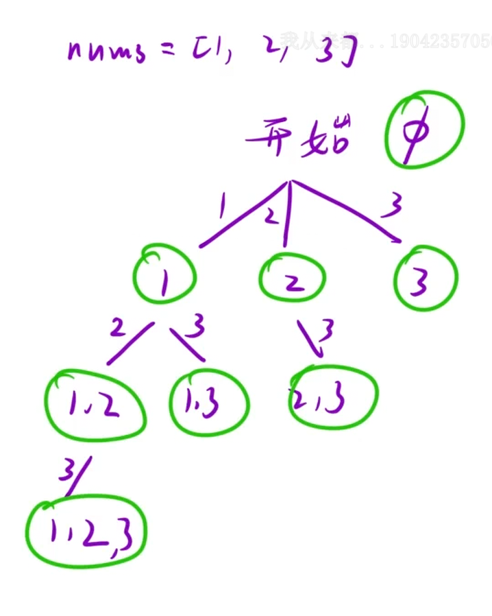

给你一个整数数组 `nums`，数组中的元素 互不相同。返回该数组所有可能的子集（幂集）。

解集 不能 包含重复的子集。你可以按 任意顺序 返回解集。

示例 1：

```C++
输入：nums = [1,2,3]
输出：[[],[1],[2],[1,2],[3],[1,3],[2,3],[1,2,3]]
```

## 思路：

决策树如下图所示，依旧是`for` 循环控制横向枚举，配合递归实现纵向深入注意这里要传一个参数`pos`记录位置，以免重复选择，从而实现天然去重的效果

这题与全排列的区别在于 子集需要去重 如果用哈希表的话需要手动去重，所以这里利用`pos`记录位置，选了 1 之后，下一层只能从 1 后面选，而全排列那里就直接从0开始再选就行了，因为[1,2]和[2,1]是不同的排列



```C++
class Solution {
public:
    vector<vector<int>> subsets(vector<int>& nums)
    {
        vector<vector<int>> ret;
        vector<int> path;
        dfs(nums,0,path,ret);
        return ret;
    }
    void dfs(vector<int>& nums,int pos,vector<int>& path,vector<vector<int>>& ret)
    {
        //每一个节点都是子集，当在递归循环中得到一个节点就直接保存
        ret.push_back(path);
        //循环+递归
        for(int i = pos;i<nums.size();i++)
        {
            path.push_back(nums[i]);
            dfs(nums,i+1,path,ret);
            path.pop_back();
        }
    }
};
```

当 `pos >= nums.size()` 时for循环不会执行，循环内的递归也不会继续，并且这里的每一个节点都是一个子集，直接保存即可，因为走到任何节点都要保存，所以不需要“触底才保存”，也就不需要 `return` 来终止。

## `dfs(nums,i+1,path,ret);`为什么要传i+1

传 `i + 1`，下一层只能从当前数字后面选：

```C++
选 1（i=0）→ 下一层从 1 开始 → 只能选 2、3
选 2（i=1）→ 下一层从 2 开始 → 只能选 3
选 3（i=2）→ 下一层从 3 开始 → 越界，停止
```

不会回头，不重复，起到去重的效果
