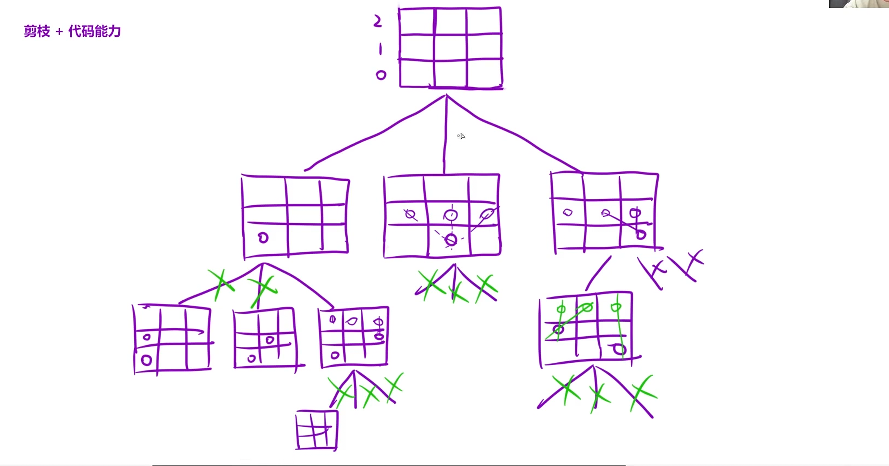
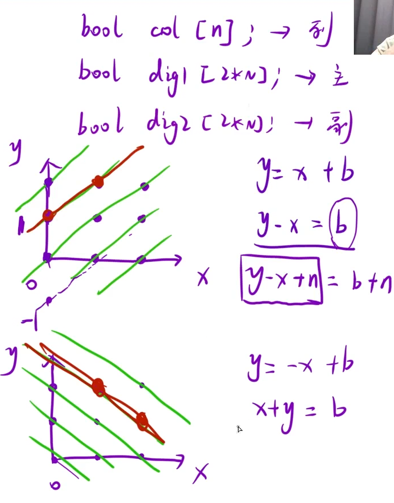

按照国际象棋的规则，皇后可以攻击与之处在同一行或同一列或同一斜线上的棋子。

n 皇后问题 研究的是如何将 `n` 个皇后放置在 `n×n` 的棋盘上，并且使皇后彼此之间不能相互攻击。

给你一个整数 `n`，返回所有不同的 n 皇后问题 的解决方案。

每一种解法包含一个不同的 n 皇后问题 的棋子放置方案，该方案中 `'Q'` 和 `'.'` 分别代表了皇后和空位。

示例 1：


```C++
输入：n = 4
输出：[[".Q..","...Q","Q...","..Q."],["..Q.","Q...","...Q",".Q.."]]
解释：如上图所示，4 皇后问题存在两个不同的解法。
```





## 思路：

这题要对纵向 横向 正对角线 反对角线进行分析，其中横向与纵向就是最基本的递归，用一个bool数组判断即可，然而正对角线和反对角线涉及到数学转换，将每一个格子抽象为一个点，然后画出对角线，可知一共有2n-1个对角线，所以用两个bool数组：`dig1`和`dig2`来判断正对角和斜对角是否存在两个数，并且初始化为`2n`的空间，正对角由

`y - x + n= b + n`是否为真判断，由图可知 正对角线的b会涉及到负数，所以这里`+n`是为了保证都为非负整数,斜对角线直接判断`y + x = b`即可

```C++
class Solution {
    vector<vector<string>> ret;
public:
    vector<vector<string>> solveNQueens(int n)
    {
        //创建一个n*n大小的棋盘 全部放'.'，若符合条件就用'Q'替换
        vector<string> board(n,string(n,'.'));
        //创建三个bool数组标记状态
        vector<bool> col(n,false);
        vector<bool> dig1(2*n,false);
        vector<bool> dig2(2*n,false);
        dfs(n,0,board,col,dig1,dig2);
        return ret;
    }
    void dfs(int n,int row,vector<string>& board,vector<bool>& col,vector<bool>& dig1,vector<bool>& dig2)
    {
        //递归出口
        if(row == n)
        {
            ret.push_back(board);
            return;
        }
        //在row行的每一列尝试放上皇后并且处理斜角的情况
        for(int i = 0;i<n;i++)
        {
            int idx1 = row - i + n;
            int idx2 = row + i;
            //如果列或者对角被占用,就跳过这个格子
            if(col[i] || dig1[idx1] || dig2[idx2]) continue;
            //放上皇后 标记占用
            board[row][i] = 'Q';
            col[i] = true;
            dig1[idx1] = true;
            dig2[idx2] = true;
            dfs(n,row+1,board,col,dig1,dig2);
            //回溯 恢复现场
            board[row][i] = '.';
            col[i] = false;
            dig1[idx1] = false;
            dig2[idx2] = false;
        }
    }
};
```
