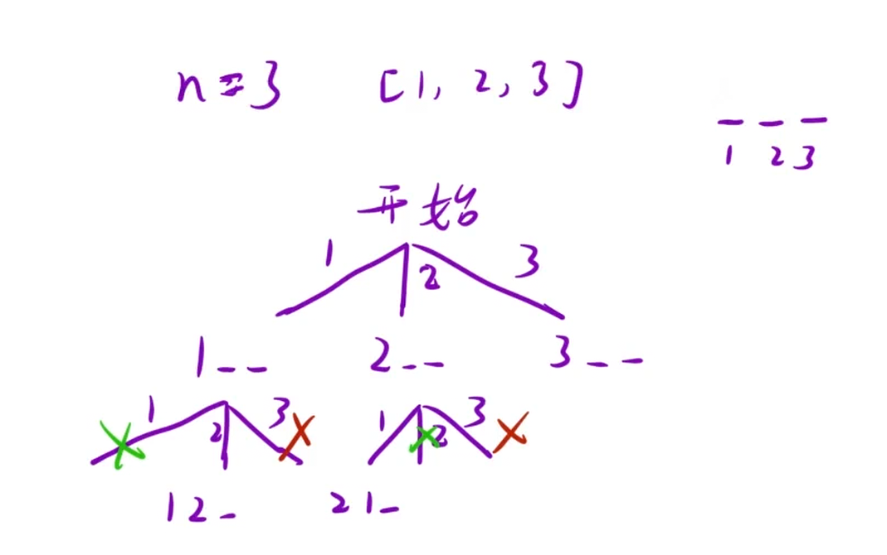

假设有从 1 到 n 的 n 个整数。用这些整数构造一个数组 `perm`（下标从 1 开始），只要满足下述条件 之一，该数组就是一个 优美的排列：

- `perm[i]` 能够被 `i` 整除

- `i` 能够被 `perm[i]` 整除

给你一个整数 `n`，返回可以构造的 优美排列 的 数量。

示例 1：

```C++
输入：n = 2
输出：2
解释：
第 1 个优美的排列是 [1,2]：
    - perm[1] = 1 能被 i = 1 整除
    - perm[2] = 2 能被 i = 2 整除
第 2 个优美的排列是 [2,1]:
    - perm[1] = 2 能被 i = 1 整除
    - i = 2 能被 perm[2] = 1 整除
```



### 核心思路

1. 决策树：你有 `n` 个位置（从 1 到 n），每次从 1 到 n 里选一个还没用过的数字放到当前位置。

2. 判断合法性：如果选出来的数字 `i`，和当前位置 `pos`，满足 `i % pos == 0` 或者 `pos % i == 0`，这个数字才能放在这里。

3. 递归出口：如果所有位置都填满了（`pos > n`），说明找到了一个合法排列，`count++`。

4. 回溯：用 `used` 数组记录哪些数字用过了，选完退回。

```C++
class Solution {
    int count = 0;
public:
    int countArrangement(int n) {
        vector<bool> used(n + 1, false); // 下标 1~n 记录数字用没用过
        dfs(n, 1, used);                 // 从第 1 个位置开始填
        return count;
    }

    // pos 代表当前正在填第几个位置
    void dfs(int n, int pos, vector<bool>& used) {
        // 递归出口：位置填完了
        if (pos > n) {
            count++;
            return;
        }

        // 选出原数组的数字 1~n 放到当前 pos 位置
        for (int i = 1; i <= n; i++) {
            // 如果没用过，且满足整除条件
            if (!used[num] && (num % pos == 0 || pos % num == 0)) {
                used[num] = true;      // 标记用过
                dfs(n, pos + 1, used); // 填下一个位置
                used[num] = false;     // 回溯
            }
        }
    }
};
```
