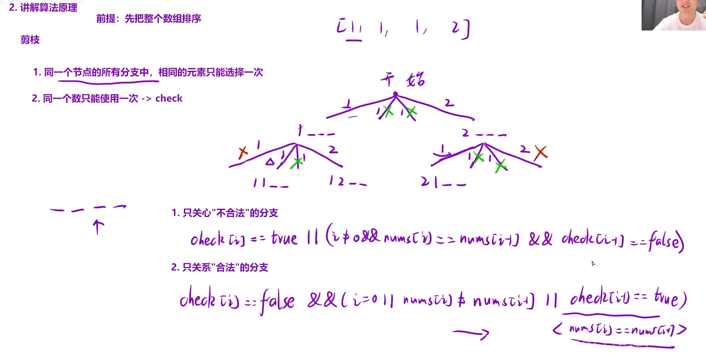

给定一个可包含重复数字的序列 `nums`，*按任意顺序* 返回所有不重复的全排列。

示例 1：

```C++
输入：nums = [1,1,2]
输出：
[[1,1,2],
 [1,2,1],
 [2,1,1]]
```

## 思路：



通过判断“不合法”分支剪枝：当

选定的数已经用过了了 `||` ( i `≠` 0 `&&` 选定的数 `==` 前面一个数 `&&` 前面一个数没用过)

当命中上述条件时不再进行递归 直接`continue`进入下一次循环

### 为什么`&&` 前面一个数没用过：在第二层符合`选定的数 == 前面一个数`却依旧符合递归条件是因为 这涉及到一个数在哪一层使用，比如第一层的第一个1状态是true在第一层使用，而第二层第一个1就是false，所以第二层的第二个“重复”的1是可用的，也就是在第二层使用的实际是第二个1

```C++
class Solution {
public:
    vector<vector<int>> permuteUnique(vector<int>& nums)
    {
        sort(nums.begin(),nums.end());
        vector<vector<int>> ret;
        vector<int> path;
        vector<bool> used(nums.size(),false);
        dfs(nums,used,path,ret);
        return ret;
    }
    void dfs(vector<int>& nums,vector<bool>& used,vector<int>& path,vector<vector<int>>& ret)
    {
        //递归出口
        if(path.size() == nums.size())
        {
            ret.push_back(path);
            return;
        }
        //循环控制横向 递归控制纵向
        for(int i = 0;i<nums.size();i++)
        {
            //通过“不合法”剪枝
            if(used[i] == true || (i > 0 && nums[i] == nums[i-1] && used[i-1] == false))
            continue;
            //递归
            path.push_back(nums[i]);
            used[i] = true;
            dfs(nums,used,path,ret);
            path.pop_back();
            used[i] = false;
        }
    }
};
```
