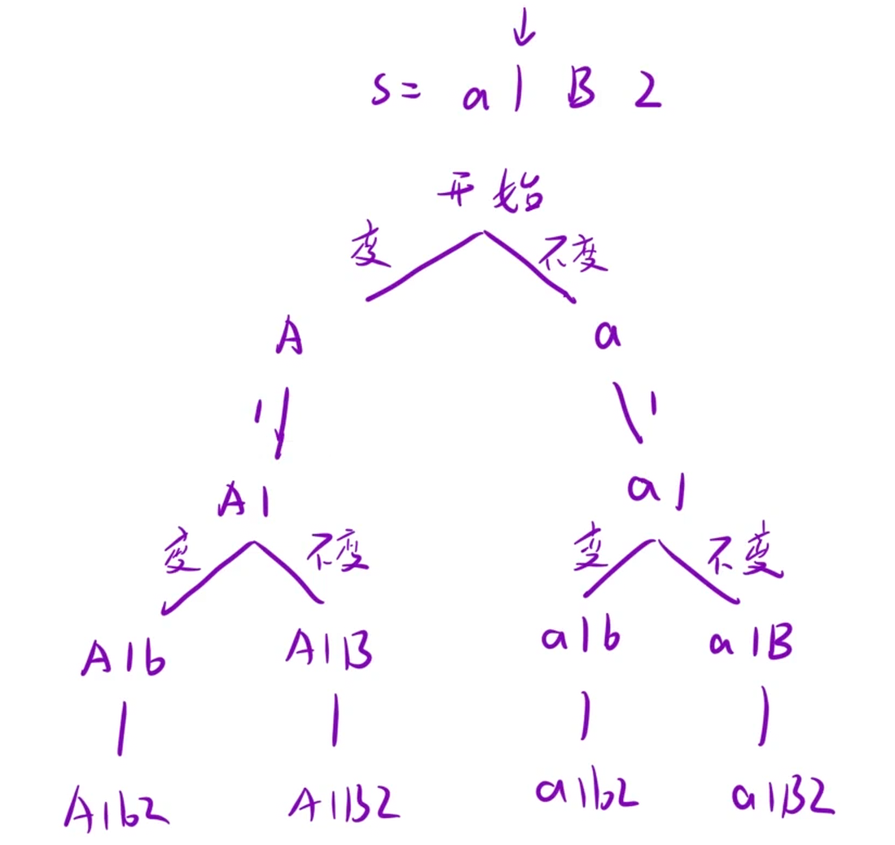

给定一个字符串 `s`，通过将字符串 `s` 中的每个字母转变大小写，我们可以获得一个新的字符串。

返回 所有可能得到的字符串集合。以 任意顺序 返回输出。

示例 1：

```C++
输入：s = "a1b2"
输出：["a1b2", "a1B2", "A1b2", "A1B2"]
```

示例 2:

```C++
输入: s = "3z4"
输出: ["3z4","3Z4"]
```



| 函数 | 作用 |
| --- | --- |
| isdigit(c) | 判断是否是数字 |
| islower(c) | 判断是否是小写字母 |
| toupper(c) | 转成大写字母 |
| tolower(c) | 转成小写字母 |

## 思路：

1. 遍历：从左到右遍历字符串 `s`。

2. 判断：

  - 如果是数字：只有一种选择，直接加进去，递归下一位。

  - 如果是字母：有两种选择（保持原样，或者切换大小写）。

3. 出口：当路径长度等于字符串长度时，说明所有字符都处理完了，保存结果。

```C++
class Solution {
public:
    vector<string> letterCasePermutation(string s)
    {
        vector<string> ret;
        string path;
        dfs(s,0,path,ret);
        return ret;
    }
    void dfs(string& s,int pos,string& path,vector<string>& ret)
    {
        if(path.size() == s.size())
        {
            ret.push_back(path);
            return;
        }
        char c = s[pos];
        //是数字 直接加进去 递归
        if(isdigit(c))
        {
            path.push_back(c);
            dfs(s,pos+1,path,ret);
            path.pop_back();
        }
        //是字母 分两种情况讨论
        else
        {
            //1.保持原样直接加入
            path.push_back(c);
            dfs(s,pos+1,path,ret);
            path.pop_back();
            //2.切换大小写加入
            if(islower(c))
            path.push_back(toupper(c));
            else
            path.push_back(tolower(c));
            dfs(s,pos+1,path,ret);
            path.pop_back();
        }
    }
};
```
