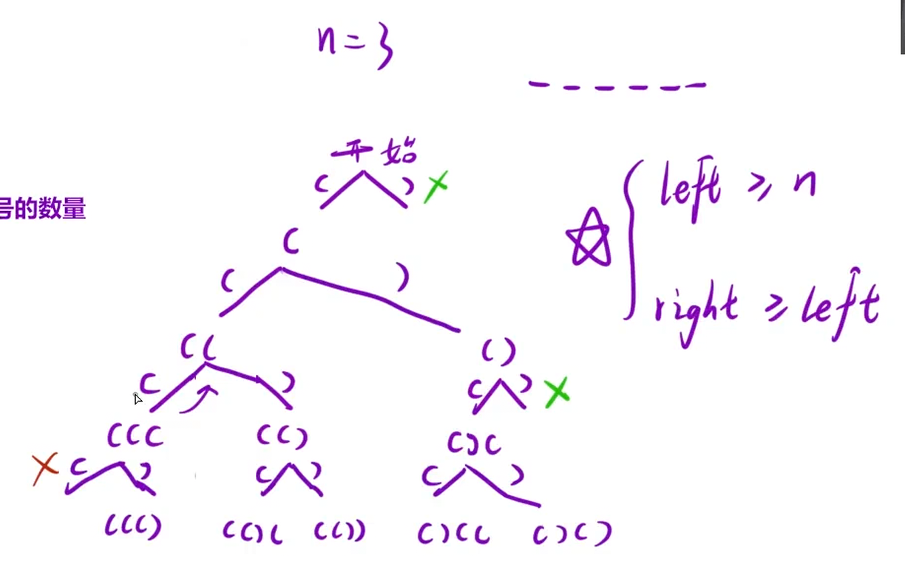

数字 `n` 代表生成括号的对数，请你设计一个函数，用于能够生成所有可能的并且 有效的 括号组合。

示例 1：

```C++
输入：n = 3
输出：["((()))","(()())","(())()","()(())","()()()"]
```

### 有效括号的两个条件：

1.左括号的数量 = 右括号的数量

2.从头开始的任意一个字串都有左括号数量 ≥ 右括号数量

## 思路：

画出决策树，同时记录左括号和右括号的数量，通过“不合法”剪枝，也就是左括号的数量 = n和右括号的数量 ≥ 左括号的数量就终止



```C++
class Solution {
public:
    vector<string> generateParenthesis(int n)
    {
        string path;
        vector<string> ret;
        dfs(path,0,0,ret,n);
        return ret;
    }
    void dfs(string& path,int left,int right,vector<string>& ret,int n)
    {
       //递归出口
       if(path.size() == n * 2)
       {
        ret.push_back(path);
        return;
       }
       //不合法剪枝
       if(left == n)
       {
        //剪枝，啥也不做
       }
       else
       {
        path.push_back('(');
        dfs(path,left+1,right,ret,n);
        path.pop_back();
       }
       if(right >= left)
       {
        //剪枝
       }
       else
       {
        path.push_back(')');
        dfs(path,left,right+1,ret,n);
        path.pop_back();
       }
    }
};
```
