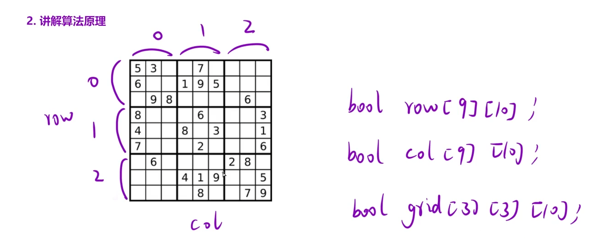

请你判断一个 `9 x 9` 的数独是否有效。只需要 根据以下规则，验证已经填入的数字是否有效即可。

1. 数字 `1-9` 在每一行只能出现一次。

2. 数字 `1-9` 在每一列只能出现一次。

3. 数字 `1-9` 在每一个以粗实线分隔的 `3x3` 宫内只能出现一次。（请参考示例图）

注意：

- 一个有效的数独（部分已被填充）不一定是可解的。

- 只需要根据以上规则，验证已经填入的数字是否有效即可。

- 空白格用 `'.'` 表示。

示例 1：


```C++
输入：board =
[["5","3",".",".","7",".",".",".","."]
,["6",".",".","1","9","5",".",".","."]
,[".","9","8",".",".",".",".","6","."]
,["8",".",".",".","6",".",".",".","3"]
,["4",".",".","8",".","3",".",".","1"]
,["7",".",".",".","2",".",".",".","6"]
,[".","6",".",".",".",".","2","8","."]
,[".",".",".","4","1","9",".",".","5"]
,[".",".",".",".","8",".",".","7","9"]]
输出：true
```



## 思路：

建立三个`bool`数组，三个二维数组(判断行/列/九宫格是否用过某一个数)，遍历+查重无需回溯，不需要递归

```C++
class Solution {
public:
    bool isValidSudoku(vector<vector<char>>& board)
    {
        bool col[9][10];
        bool row[9][10];
        bool box[3][3][10];
        for(int i = 0;i<9;i++)
        {
            for(int j = 0;j<9;j++)
            {
                if(board[i][j] == '.') continue;
                else
                {
                    int num = board[i][j] - '0';
                    if(col[j][num] || row[i][num] || box[i/3][j/3][num])
                    return false;
                    //修改状态
                    col[j][num] = true;
                    row[i][num] = true;
                    box[i/3][j/3][num] = true;
                }
            }
        }
        return true;
    }
};
```
