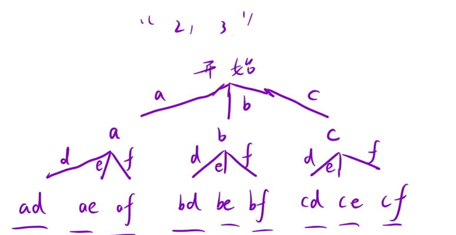

给定一个仅包含数字 `2-9` 的字符串，返回所有它能表示的字母组合。答案可以按 任意顺序 返回。

给出数字到字母的映射如下（与电话按键相同）。注意 1 不对应任何字母。


示例 1：

```C++
输入：digits = "23"
输出：["ad","ae","af","bd","be","bf","cd","ce","cf"]
```

## 思路：

先画决策树，将`dights`转化为数字，再用一个`string`分别表示数字映射的字母，再用范围for遍历映射的字母实现横向枚举，同时递归纵向深入，再回溯即可完成，这里pos的作用主要是实现

`pos+1`的作用主要是作用于

```C++
int digit = digits[pos] - '0';
string letters = a[digit];
```

具体对应关系如下：

```C++
digits = "2"   "3"
pos:      0     1
letters: "abc" "def"
```



```C++
class Solution {
    vector<string> a = {" "," ","abc","def","ghi","jkl","mno","pqrs","tuv","wxyz"};
public:
    vector<string> letterCombinations(string digits)
    {
        string path;
        vector<string> res;
        if(digits.empty()) return res;
        dfs(digits,0,path,res);
        return res;
    }
    void dfs(string& digits,int pos,string& path,vector<string>& res)
    {
        if(digits.size() == path.size())
        {
            res.push_back(path);
            return;
        }
        int digit = digits[pos] - '0';
        string letters = a[digit];
        for(char c : letters)
        {
            path.push_back(c);
            dfs(digits,pos+1,path,res);
            path.pop_back();
        }
    }
};
```
