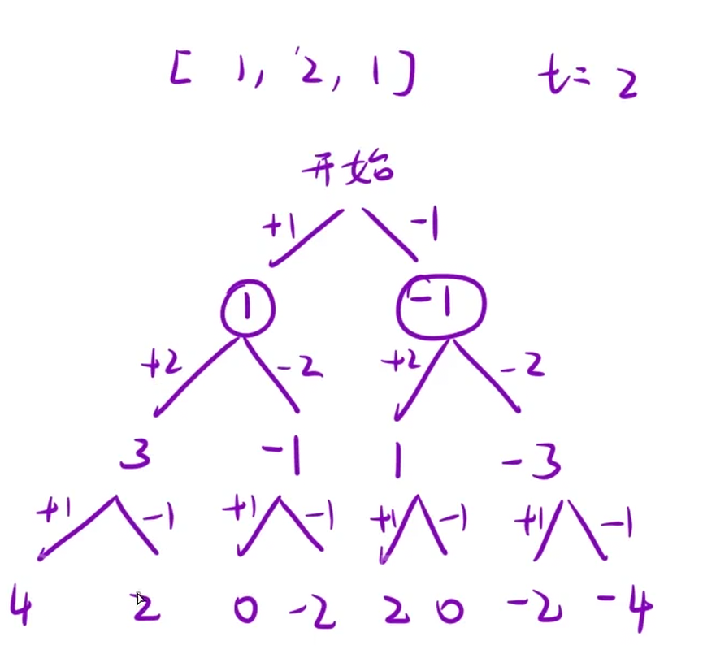

给你一个非负整数数组 `nums` 和一个整数 `target`。

向数组中的每个整数前添加 `'+'` 或 `'-'`，然后串联起所有整数，可以构造一个 表达式：

- 例如，`nums = [2, 1]`，可以在 `2` 之前添加 `'+'`，在 `1` 之前添加 `'-'`，然后串联起来得到表达式 `"+2-1"`。

返回可以通过上述方法构造的、运算结果等于 `target` 的不同 表达式 的数目。

示例 1：

```C++
输入：nums = [1,1,1,1,1], target = 3
输出：5
解释：一共有 5 种方法让最终目标和为 3 。
-1 + 1 + 1 + 1 + 1 = 3
+1 - 1 + 1 + 1 + 1 = 3
+1 + 1 - 1 + 1 + 1 = 3
+1 + 1 + 1 - 1 + 1 = 3
+1 + 1 + 1 + 1 - 1 = 3
```



## 思路：

画出决策树，根据+或者-进行递归，与子集类似，比较简单。

```C++
class Solution {
int count = 0;
public:
    int findTargetSumWays(vector<int>& nums, int target)
    {
        dfs(nums,target,0,0);
        return count;
    }
    void dfs(vector<int>& nums,int target,int index,int currentsum)
    {
        if(index == nums.size())
        {
            if(currentsum == target)
            count++;
            return;
        }
        //加上这个数字
        dfs(nums,target,index+1,currentsum + nums[index]);
        //减去这个数字
        dfs(nums,target,index+1,currentsum - nums[index]);
    }
};
```
