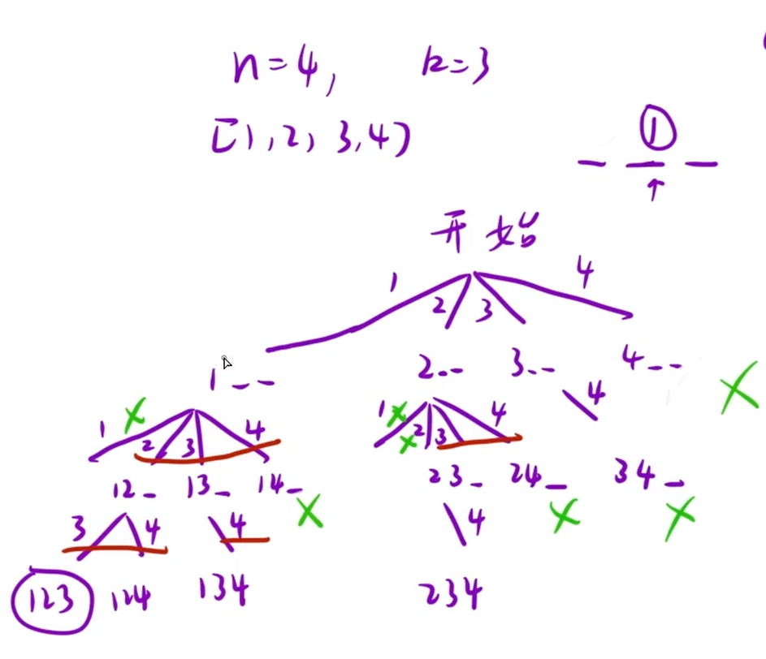

给定两个整数 `n` 和 `k`，返回范围 `[1, n]` 中所有可能的 `k` 个数的组合。

你可以按 任何顺序 返回答案。

示例 1：

```C++
输入：n = 4, k = 2
输出：
[
  [2,4],
  [3,4],
  [2,3],
  [1,2],
  [1,3],
  [1,4],
]
```

## 思路：

由下图的决策树可知，当固定一个数的时候，只需枚举在它后面的数就行，包括本身在内的前面的数都是重复的，所以这里的函数体设计就要用到，仅收集叶子节点的结果，这题与子集类似，不能重复，所以有i+1这个操作



```C++
class Solution {
public:
    vector<vector<int>> combine(int n, int k)
    {
        vector<int> path;
        vector<vector<int>> ret;
        dfs(n,k,1,path,ret);
        return ret;
    }
    void dfs(int n,int k,int pos,vector<int>& path,vector<vector<int>>& ret)
    {
        if(path.size() == k)
        {
            ret.push_back(path);
            return;
        }
        for(int i = pos;i<=n;i++)
        {
            path.push_back(i);
            dfs(n,k,i+1,path,ret);
            path.pop_back();
        }
    }
};
```
