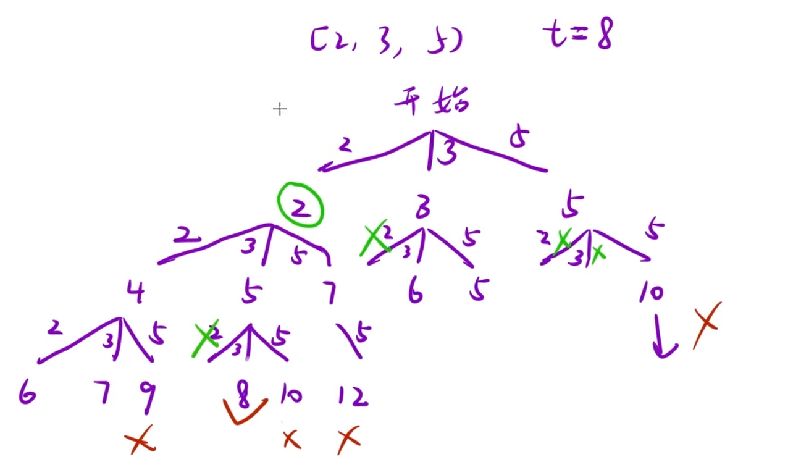

给你一个 无重复元素 的整数数组 `candidates` 和一个目标整数 `target`，找出 `candidates` 中可以使数字和为目标数 `target` 的 所有 不同组合，并以列表形式返回。你可以按 任意顺序 返回这些组合。

`candidates` 中的 同一个 数字可以 无限制重复被选取。如果至少一个数字的被选数量不同，则两种组合是不同的。

对于给定的输入，保证和为 `target` 的不同组合数少于 `150` 个。

示例 1：

```C++
输入：candidates = [2,3,6,7], target = 7
输出：[[2,2,3],[7]]
解释：
2 和 3 可以形成一组候选，2 + 2 + 3 = 7 。注意 2 可以使用多次。
7 也是一个候选， 7 = 7 。
仅有这两种组合。
```



## 思路：

这题是没有顺序的，也就是 2 3,3 2属于同一种 要剪枝，根据决策图可知，当下一层开始选数的时候，只能选上一层选的数以及他后面的数，在他之前的数都要剪枝，所以这里要传参`pos`表示上一层选了什么数，注意这里传`i`不是`i+1`，其他的就跟目标和差不多

```C++
class Solution {
public:
    vector<vector<int>> combinationSum(vector<int>& candidates, int target)
    {
        vector<int> path;
        vector<vector<int>> ret;
        dfs(candidates,target,0,0,path,ret);
        return ret;
    }
    void dfs(vector<int>& candidates,int target,int pos,int currentsum,vector<int>& path,vector<vector<int>>& ret)
    {
        //剪枝
        if(currentsum > target) return;
        //递归出口
        if(currentsum == target)
        {
            ret.push_back(path);
            return;
        }
        for(int i = pos;i<candidates.size();i++)
        {
            path.push_back(candidates[i]);
            dfs(candidates,target,i,currentsum + candidates[i],path,ret);
            path.pop_back();
        }

    }
};
```
