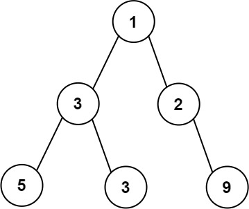
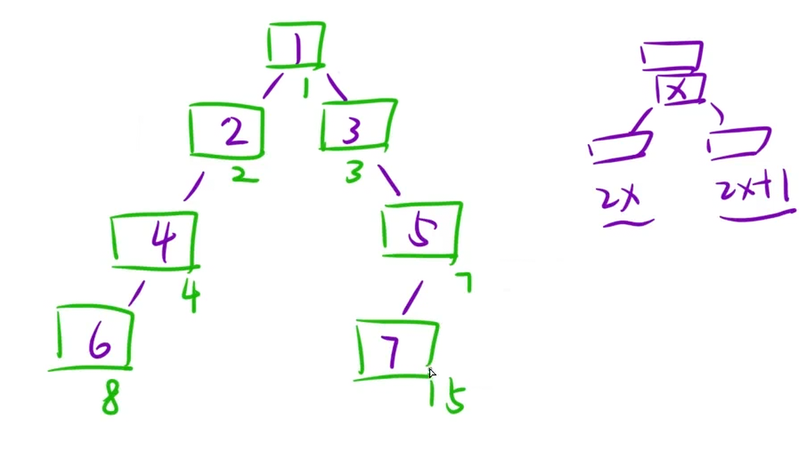

给你一棵二叉树的根节点 `root`，返回树的 最大宽度。

树的 最大宽度 是所有层中最大的 宽度。

每一层的 宽度 被定义为该层最左和最右的非空节点（即，两个端点）之间的长度。将这个二叉树视作与满二叉树结构相同，两端点间会出现一些延伸到这一层的 `null` 节点，这些 `null` 节点也计入长度。

题目数据保证答案将会在 32 位 带符号整数范围内。

示例 1：



```C++
输入：root = [1,3,2,5,3,null,9]
输出：4
解释：最大宽度出现在树的第 3 层，宽度为 4 (5,3,null,9) 。
```

## 思路

用队列存{节点，编号},如下图所示的父节点与孩节点的关系，计算每一个节点对应的编号，一层的宽度就是`right - left + 1`，再分别记录每一层的每一个数的左右孩子的节点和编号，最后取最大值。



```C++
class Solution {
public:
    int widthOfBinaryTree(TreeNode* root)
    {
        if(!root) return 0;
        //用队列记录节点和编号
        queue<pair<TreeNode*,long long>> q;
        q.push({root,0});
        //记录最大宽度
        long long maxwidth = 0;
        while(q.size())
        {
            int sz = q.size();
            //记录每一层左节点和右节点的编号
            long long left = q.front().second;
            long long right = left;//此时还未遍历，与左重合
            for(int i = 0;i<sz;i++)
            {
                auto p = q.front();
                q.pop();
                TreeNode* node = p.first;
                long long id = p.second;
                //更新右节点编号
                right = id;
                //判断下一层左右是否为空，不为空就加入队列并标上编号
                if(node->left) q.push({node->left,(id - left)*2 + 1});
                if(node->right) q.push({node->right,(id-left)*2 + 2});
            }
            //遍历完一层就统计最大值
            maxwidth = max(maxwidth,right - left + 1);
        }
        return maxwidth;
    }
};
```

### 为什么要用`(id - left)*2 + 1`而不直接用`id * 2 + 1`？

假设同一层有两个节点，左边是 `left`，右边是 `right`。
原本的宽度是：`right - left + 1`。
现在我们给所有节点都减去 `left`：

- 左边变成了：`left - left = 0`

- 右边变成了：`right - left` = `i`

- 现在的宽度是：`(right - left) - 0 + 1 = right - left + 1`

`(id - left) * 2 + 1` 的意思是：“先把当前节点的绝对坐标，换算成从 0 开始的相对坐标（防溢出），然后再套用满二叉树 ‘左 2i+1，右 2i+2’ 的公式，去算出它孩子的新坐标。”

`left →left - left`  `i = i - left`
