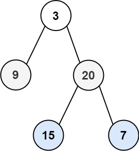

给你二叉树的根节点 `root`，返回其节点值的 锯齿形层序遍历。（即先从左往右，再从右往左进行下一层遍历，以此类推，层与层之间交替进行）。

示例 1：



```C++
输入：root = [3,9,20,null,null,15,7]
输出：[[3],[20,9],[15,7]]
```

## 思路：

增加一个标记位，这里我选择用一个`int level`判断到了第几层，在最后通过 `level % 2`判断奇偶，若是偶数就逆置

```C++
class Solution {
public:
    vector<vector<int>> zigzagLevelOrder(TreeNode* root)
    {
        int level = 1;
        vector<vector<int>> ret;
        queue<TreeNode*> q;
        if(root == nullptr) return ret;
        q.push(root);
        while(q.size())
        {
            int sz = q.size();
            vector<int> tmp;
            for(int i = 0;i<sz;i++)
            {
                auto t =  q.front();
                tmp.push_back(t->val);
                q.pop();
                if(t->left) q.push(t->left);
                if(t->right) q.push(t->right);
            }
            if(level % 2 == 0) reverse(tmp.begin(),tmp.end());
            ret.push_back(tmp);
            level++;
        }
        return ret;
    }
};
```
