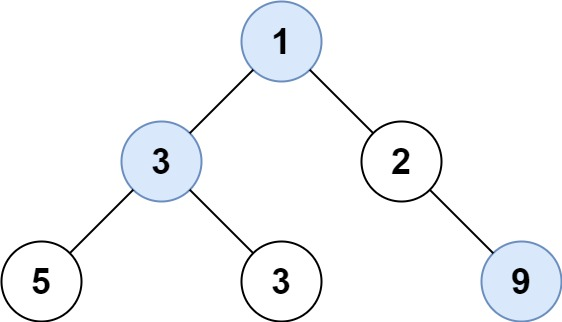

给定一棵二叉树的根节点 `root`，请找出该二叉树中每一层的最大值。

示例1：



```C++
输入: root = [1,3,2,5,3,null,9]
输出: [1,3,9]
```

## 思路：

将`maxval`初始化为最小值，遍历每一层，用当前遍历到的节点的值与maxval相比，取最大，当一层结束之后就将最大值存到ret

```C++
class Solution {
public:
    vector<int> largestValues(TreeNode* root)
    {
        queue<TreeNode*> q;
        vector<int> ret;
        if(!root) return ret;
        q.push(root);
        while(q.size())
        {
            int sz = q.size();
            vector<int> tmp;
            int maxval = INT_MIN;
            for(int i = 0;i<sz;i++)
            {
                auto node = q.front();
                tmp.push_back(node->val);
                q.pop();
                maxval = max(maxval,node->val);
                if(node->left) q.push(node->left);
                if(node->right) q.push(node->right);
            }
            ret.push_back(maxval);
        }
        return ret;
    }
};
```
